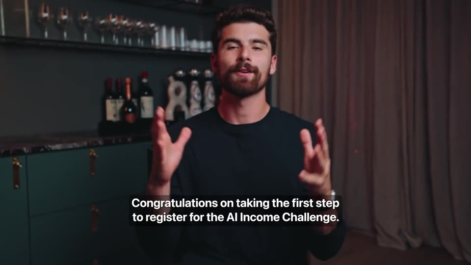
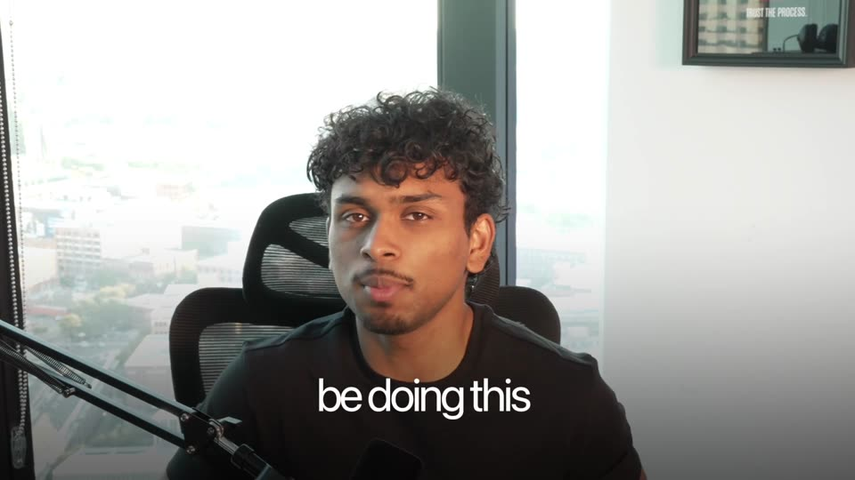

# Reference VSL breakdown

Two reference VSLs, both uploaded to the [Reference VSLs release](https://github.com/eliascroesus/jeanfx-vsl/releases/tag/reference-vsls):

- **Iman Gadzhi, "AI Income Challenge"** (`imangadzhivsl.mp4`, 2:02, 1280×720)
- **AB Trades, "The Syndicate"** (`abnasdaqvsl.mp4`, 6:13, 1920×1080)

How this was done: both videos were pulled as stills every 1–2 seconds and looked at, cuts were detected
automatically, and the audio was measured: loudness, where speech is and isn't, music level under the voice,
how regular the beat is, what fills the gaps between words, and sharp sound-effect-like hits. Example stills
are in [`frames/`](frames/). Times are approximate (±2 s).

AB's full transcript is in [AB-TRANSCRIPT.md](AB-TRANSCRIPT.md). Jean's script is built on it line by line;
the comparison is in [`03-raw-vsl-footage/BREAKDOWN.md`](../../03-raw-vsl-footage/BREAKDOWN.md). Music is described
by what can be measured (level, whether it has a beat, when it plays); the tracks themselves aren't identified.

## At a glance

| | Iman Gadzhi | AB Trades |
| --- | --- | --- |
| What it is | Thank-you-page video after sign-up: "don't close this page, finish registering" | Application VSL for a paid trading mentorship |
| Length | 2:02 | 6:13 |
| Camera | Two angles (wide + close), switched every few seconds | One camera, digital punch-ins |
| Shot changes | ~33 (one every ~3.7 s) | ~110 hard cuts (one every ~3.4 s, half of them under 1.5 s) |
| Captions | Small subtitles, full sentences, 2 lines | Big captions, 2–4 words at a time, 1 line |
| Graphics | Black + lime brand cards, mockups, screen demos in frames | White "Apple keynote" text cards, 3D objects, stock and movie clips |
| Proof | None (it's not selling) | ~2 minutes of raw screen recordings of payouts |
| Music | Soft bed with no drums under the whole video, never stops | Soft bed under the talking; a track with a steady beat takes over the proof section |
| Loudness | −12.9 LUFS, very even (loudness range 2.6 LU) | −23.9 LUFS, quiet (loudness range 7.7 LU) |

## Iman Gadzhi

### Structure

| Time | Beat | On screen |
| --- | --- | --- |
| 0:00 | Congratulates you and names the event | Wide shot, subtitles |
| 0:03 | Logo sting | "AI Income Challenge" logo on black, lime glow |
| 0:05 | Open loop: "Do not close this page, your registration is not complete yet" | Big headline over the close shot, handwritten lime sub-line |
| 0:10 | Reframe: "This is not a regular event, this is a challenge" | Full-screen text card, "CHALLENGE" underlined in lime |
| 0:14 | What you get: live sessions and workbooks | Workbook mockup fanned out |
| 0:22 | Free bonus: the Income Calculator | Screen recording of the tool inside a glowing frame, cursor clicking through |
| 0:46 | How to get it: join the WhatsApp group | Text card, then a phone mockup of the group chat |
| 0:58 | Three steps | Animated steps sliding left: continue registration → join WhatsApp → get the email |
| 1:10 | Exactly where to click | The real page, tilted in a frame, cursor hits the button, survey appears |
| 1:18 | Fill the survey, then the "VIP upgrade" | Talking head; "VIP UPGRADE" held on screen ~5 s |
| 1:35 | Reassure and repeat the call to action | Talking head, angle switches only |
| 2:00 | "I'll see you soon." | Ends |

### Editing

- **Two angles, cut on sentence breaks.** A wide frontal shot and a tighter three-quarter close-up, switched
  every 2–5 seconds, always between sentences, never mid-word. That's what makes a static talking head feel
  like it's moving. ([`iman-09-two-angles.jpg`](frames/iman-09-two-angles.jpg))
- **Everything he names appears on screen.** Workbooks are shown as a mockup, the calculator as a screen
  recording, WhatsApp as a phone. The first 70 seconds are mostly graphics; the last 50 are mostly him.
- **Text cards** ([`iman-04-text-card.jpg`](frames/iman-04-text-card.jpg)): black background with a lime
  glow in one corner, a wide all-caps font (an extended geometric face like Druk Wide or Monument Extended),
  letters blur in left to right, one keyword underlined in lime, a small logo mark at the bottom.
- **Headline over the talking head** ([`iman-03-headline-over-aroll.jpg`](frames/iman-03-headline-over-aroll.jpg)):
  the same wide caps in white across the lower third, with a lime handwritten line under it. Used once, for
  the most important instruction.
- **Callout word** ([`iman-10-callout-word.jpg`](frames/iman-10-callout-word.jpg)): when he says the key
  term ("VIP upgrade"), the subtitle disappears and the term takes its place in big caps.
- **Screens are never shown raw.** Every screen recording sits in a rounded frame on the brand background,
  sometimes tilted, with the cursor visible ([`iman-06-screen-demo.jpg`](frames/iman-06-screen-demo.jpg),
  [`iman-08-page-walkthrough.jpg`](frames/iman-08-page-walkthrough.jpg)).
- **Subtitles**: white, bold clean sans (Inter / SF Pro style), sentence case, two lines of about 35
  characters, no box, soft shadow, lower middle. They move up when a headline takes the bottom.
- **One brand system**: black, white and one accent colour (lime). Nothing else.
- **Look**: dark, moody set with warm practical lights, shallow depth of field.

### Sound

- **There's always music under him, but it's soft and has no beat.** The gaps between his words sit around
  −36 dBFS (a clean room recording is around −64) and what fills them is tonal, not hiss.
  No drums or steady beat show up anywhere, so it's a pad or ambient-style bed. It falls away only after the
  last word.
- **Voice is heavily compressed and loud** (−12.9 LUFS, loudness range 2.6 LU): every word lands at the
  same level, which is part of why it feels relentless.
- **He talks the entire time.** Speech is detected in 89–99% of every 5-second window: no pauses, no dead air.
- **Sound effects on graphics.** Sharp, bright hits (typical of whooshes and pops) land on almost every switch
  into or out of a graphic: 0:05, 0:09, 0:16, 0:22, 0:27, 0:46, 0:52, 0:58, 1:02, 1:07, 1:10.

### Why it keeps attention

1. Open loop in the first 5 seconds ("your registration is not complete yet").
2. Something new on screen every ~3.7 seconds.
3. Every promise is shown, not just said.
4. One instruction repeated three ways (calculator, WhatsApp, button), so nobody gets lost.
5. Short: two minutes, one idea per section.

## AB Trades

### Structure

| Time | Beat | On screen |
| --- | --- | --- |
| 0:00 | Hook: "Every one of these videos starts off the same exact way… screenshot after screenshot" | Stacked mixed-style text beside him, flashes of a phone screenshot and a chart |
| 0:12 | Credential: "I've made over $750,000 in prop firm payouts and live account withdrawals" | Picture-in-picture card over a chart, then a big blue number with 3D money falling |
| 0:20 | Proof dump, ~2 minutes, sped up ("feel free to pause and verify"), firm by firm, refreshing each page | Raw screen recordings of payout dashboards, emails and certificates, facecam top right |
| 2:10 | Honesty turn ("another $250,000 I can't show you"), then: the problem isn't the strategy | Big numbers on white ($250,000), "Available balance $10" card |
| 3:10 | It's human instinct, then his own blow-up story ("In February of 2025 I had a $50,000 month… the very next month I blew $75,000") | White keynote cards, movie clips, 3D brain, burning money, alarm clock |
| 4:08 | One setup, decision fatigue | "ONE SETUP" in giant letters behind his head |
| 4:16 | The fix: one setup, plus someone reviewing your trades every day | Movie clips framed on white |
| 4:36 | The offer: The Syndicate (get in, get consistent, get out) | List in the empty side of the frame, an arrow marks the current point |
| 5:00 | Case study: James, fast-food job → $24,000 in payouts in two months | Student photo card, before shot in black and white, the student's YouTube videos as proof |
| 5:20 | What's included | Split screen: him on the left, a list on black building line by line as he says it |
| 5:52 | Guarantee: a payout within 90 days or he works with you for free | Trophy, payout certificate, flying money |
| 6:02 | Call to action: fill out the application | "FOR FREE", "THE APPLICATION" in glowing blue caps |

### Editing

- **Word-group captions** ([`ab-02-word-captions.jpg`](frames/ab-02-word-captions.jpg)): 2–4 words at a
  time, one line, white, a tight Apple-style sans (SF Pro Display look), lowercase, soft shadow. They change
  every ~1 second, so something at the bottom of the frame is always moving.
- **Emphasis words** ([`ab-12-cta-emphasis.jpg`](frames/ab-12-cta-emphasis.jpg)): key words switch to bold
  caps in electric blue with a glow ("WORK WITH YOU", "FOR FREE", "THE APPLICATION").
- **Punch-ins**: one camera, but the framing alternates between wide and tight every few seconds.
- **White keynote cards** ([`ab-05-white-text-card.jpg`](frames/ab-05-white-text-card.jpg)): full-screen
  white with black text, built word by word. Used for transitions and story beats ("Now what exactly do I
  mean by this?", "In February of 2025").
- **Big-number cards** ([`ab-03-big-number.jpg`](frames/ab-03-big-number.jpg),
  [`ab-13-proof-card.jpg`](frames/ab-13-proof-card.jpg)): money in blue on white, with 3D money, coins or
  medals.
- **3D objects and stock** ([`ab-07-3d-object.jpg`](frames/ab-07-3d-object.jpg)): brain, burning cash, alarm
  clock, magnifying glass over a chart, trophy, money counter. Each lasts about a second.
- **Movie clips as metaphor** ([`ab-06-movie-clip.jpg`](frames/ab-06-movie-clip.jpg)): cinematic clips with
  the caption over them, sometimes framed on white.
- **Text in the empty side of the frame** ([`ab-09-negative-space-list.jpg`](frames/ab-09-negative-space-list.jpg)):
  lists sit beside him, with an arrow on the item he's talking about.
- **Text behind the subject** ([`ab-08-text-behind-subject.jpg`](frames/ab-08-text-behind-subject.jpg)):
  giant "ONE SETUP" with his head in front of the letters.
- **Split screen for the offer** ([`ab-11-split-screen-offer.jpg`](frames/ab-11-split-screen-offer.jpg)):
  each line appears exactly when he says it.
- **Raw proof** ([`ab-04-proof-screen-recording.jpg`](frames/ab-04-proof-screen-recording.jpg)): the proof
  section isn't polished; it's real dashboards and inboxes scrolled with a facecam, which reads as authentic.
  Gmail's yellow search highlights make the dollar amounts jump out.
- **Case study cards** ([`ab-10-case-study.jpg`](frames/ab-10-case-study.jpg)): photo in a white frame plus a
  one-line headline, then the student's own videos as proof.

### Sound

- **A soft bed under the talking.** The gaps between words sit around −43 dBFS and are tonal, with no
  detectable beat, so it's quieter and more in the background than Iman's.
- **A track with a steady beat takes over the proof section** (about 1:00–2:10). That's the only stretch with a
  clear rhythm, and twice he stops talking completely (about 1:00–1:18 and 1:39–2:07) while payouts scroll.
  It's a breather after a lot of talking, and it lets the numbers speak.
- **Quiet master** (−23.9 LUFS). On players that don't level the volume, this plays much quieter than other
  videos. Don't copy this part.
- **Sound effects on graphics.** Sharp, bright hits (typical of whooshes and pops) come about every 6 seconds;
  19 of them land exactly on cuts.

### Why it keeps attention

1. The hook promises to explain something every viewer has seen ("every one of these videos").
2. Proof comes in the first 20 seconds and keeps going for two minutes, so trust is built before the pitch.
3. A new cut every ~3.4 seconds and a new caption every ~1 second.
4. Every abstract idea gets a concrete picture (instinct = brain, losses = burning money, time = clock).
5. A personal failure story ("I blew $75,000") before the solution.
6. The offer is shown building line by line, so you watch it being assembled.
7. Risk reversal right before the call to action.

## Music, measured more closely

Measured on the Ricky project from these same two files (the full method is in that repo's
`01-vsls/reference-vsls/IMAN-AUDIO.md`). Both voices sit dead centre, so subtracting one stereo channel from the
other leaves only the music.

| | Iman Gadzhi | AB Trades |
| --- | --- | --- |
| Starts | On the first frame, thin and airy, then a big low hit with a whoosh right after the hook (3.3 s) | Under the first words |
| Pulse | ~102 BPM, a crisp shaker/hat tick on every 16th, panned wide | No steady beat under the talking; a beat-driven track only under the proof section |
| Strings | Chord change every ~1.1 s over a bass walking down A-G-F-E; violins re-bowing on every 16th; an E pedal ticking in eighths | A held two-note chord changing every ~2 s, with freer broken chords on top (~3 notes a second) |
| Texture change | Every ~9 s (median 6 s) | Every ~10 s (median 6 s) |
| Level under the voice | 12–15 dB | ~17 dB |
| Never stops | Yes | Yes |

What both share: something moves at three speeds at once. Fast (ticks or broken chords), medium (a chord change
every 1–2 s), slow (the texture shifts every 6–10 s). That's what keeps the tension without anyone noticing the
music.

## What to take for Jean's VSL

Jean's raw recording (`jeanfxvsl.mov`, 8:39) is one fixed 1080p camera: a medium shot of him in a high-rise
apartment at night, city lights through the window, a warm amber lamp and a beige sofa. From 0:21 to 1:52 it's a
screen recording of his prop firm dashboards and payout emails with his face in the top right. Full breakdown:
[`03-raw-vsl-footage/BREAKDOWN.md`](../../03-raw-vsl-footage/BREAKDOWN.md).

**AB is the model, not just a reference.** Jean's script is AB's script rewritten for him: same hook, same
honesty turn, same "it's not a better indicator", same 90-day "get in, get consistent, get out", same three
inclusions, same guarantee and close. So the edit should follow AB's edit, with Iman's consistency on top:

- **Hook**: on "screenshot after screenshot after screenshot", flash the Discord payout posts from
  `02-results-and-b-roll/` one per word, faster and faster, then cut them dead on "but I'm going to be doing this
  one differently". Then a big number for "$120,000" (once the number is confirmed, see the breakdown).
- **Captions like AB's**: 2–4 words at a time, one line, white, tight Apple-style sans with a soft shadow, key
  words and every dollar amount in one accent colour.
- **One accent colour, used everywhere**: JeanFX's brand colour if there is one. Otherwise warm gold, which
  matches the lamp in his room and FTMO's gold "Overall rewards" card.
- **Always-moving shot**: AB's face shots slowly push in or pull out 15–25% over 5–15 s. Jean's footage is 1080p,
  not 4K, so stay at or under about 1.25× zoom or it goes soft. The zooms also hide the jump cuts between takes.
- **Proof section like AB's**: AB says "I'm going to speed this up, pause to verify" and lets music carry the
  scrolling. Jean talks over all 1:31 of his with a lot of "you guys can see". Tighten it, zoom into each number
  on his screen, and land one big number per firm (Topstep $36,671 → FTMO $26,915.51 → Alpha Capital $4,956 →
  Equity Edge $1,680 → Breakthrough $2,291.62), with the clean certificates from `02-results-and-b-roll/` where the
  screen recording is too small to read.
- **White keynote cards** for the problem section, which is AB's wording almost word for word ("It's not a
  better indicator. / It's not more confluences. / It's not another course you need to buy.").
- **Text behind his head**: AB's "ONE SETUP" becomes "INDUCEMENT SETUP".
- **Live chart examples** for the setup: Jean's own US30 and EURUSD trades from this month
  (`IMG_9231.PNG`, `IMG_9272.PNG`) show exactly what he describes (a sweep, then the entry), annotated step by step.
- **Case study cards**: Kibron (FTMO $17,475.33), Lawrence (QT Funded $6,196) and Desmond's six FundedNext payouts
  in a row for "over and over and over again".
- **Split screen for "what's included"**, each line appearing as he says it, then the guarantee with a payout
  certificate and "FOR FREE" in the accent colour.
- **Music**: a soft bed with no beat under all the talking, a beat-driven track under the proof section, never
  silent. Final mix at −14 LUFS with peaks under −1 dB (AB's −23.9 LUFS master is too quiet to copy).
- **Sound effects**: a whoosh on each graphic, a pop when a number lands, a cash-register sound on the biggest
  payouts. Sparingly.

**What carries over from the Ricky edit** (`rickyvsl-clips/04-edit/`): variant B there is already an AB Nasdaq-style
build (word-group captions, accent-colour key phrases, the always-moving zoom, keynote cards, text behind the head,
split-screen offer, whooshes and pops), and the music and sound-effect tools are reusable. Points that came out of
that edit: no zoom on the very first shot, keep the score's short hits and rolls but drop long sub "booms", and
keep sound effects a few dB under the voice.
